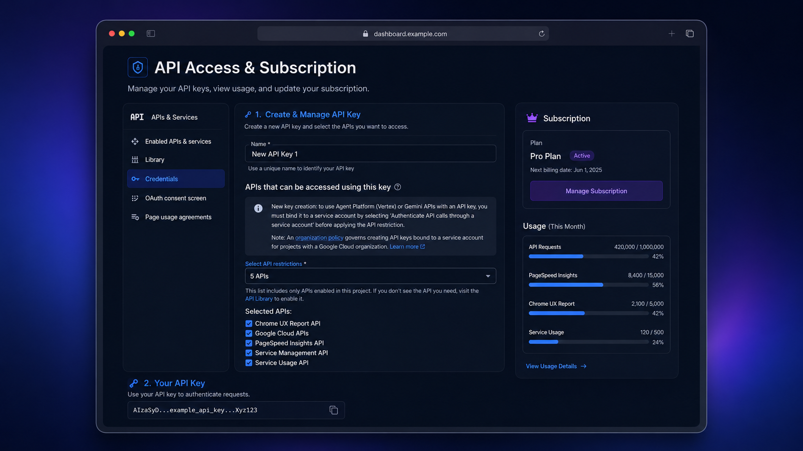

# Getting Started

This guide will help you set up the Switas Web Performance MCP server and connect it to your MCP client (Claude Desktop, Cursor, Codex, Grok, etc.).

## Prerequisites

Before you begin, ensure you have the following:

1.  **Node.js**: Version 20.19.0 or higher (`node -v`).
2.  **Google API Key**: Required to access the PageSpeed Insights API.

### Obtaining a Google API Key

To use the Switas Web Performance MCP server, you need a Google API key with the PageSpeed Insights API enabled.

!!! tip "⚡ Quick Setup Link"
    You can go directly to the **[Google Cloud Credentials Setup Page](https://console.cloud.google.com/apis/credentials/key/)** to quickly create or manage API keys in your project.

#### Step-by-Step Guide

1.  Go to the [Google Cloud Console](https://console.cloud.google.com/) (or use the [Quick Setup Link](https://console.cloud.google.com/apis/credentials/key/)).
2.  Create a new project or select an existing one.
3.  Navigate to **APIs & Services** > **Library**.
4.  Search for **"PageSpeed Insights API"** and click **Enable**.
5.  Go to **APIs & Services** > **Credentials**.
6.  Click **Create Credentials** > **API Key**.
7.  Copy the generated key.



## Installation

Clone and build from source:

```bash
git clone https://github.com/switaslabs/web-performance-mcp.git
cd web-performance-mcp
npm ci
npm run build
```

Or build the Docker image:

```bash
docker build -t web-performance-mcp .
```

## Configuration

The server is configured via environment variables.

| Variable | Description | Required | Default | Valid Values |
| :--- | :--- | :--- | :--- | :--- |
| `GOOGLE_API_KEY` | Your Google PageSpeed Insights API Key | **Yes** | — | Non-empty string |
| `WPT_API_KEY` | WebPageTest API key for the `wpt_*` tools | No | — | Non-empty string |
| `LOG_LEVEL` | Logging level | No | `info` | `trace`, `debug`, `info`, `warn`, `error`, `fatal` |
| `MAX_CONCURRENCY` | Maximum concurrent requests | No | `3` | `1` – `10` |
| `REQUEST_TIMEOUT` | HTTP request timeout in milliseconds | No | `30000` | `1000` – `60000` |
| `RETRY_ATTEMPTS` | Network failure retry attempts | No | `3` | `0` – `5` |
| `CACHE_TTL` | Cache time-to-live in seconds | No | `3600` | `60` – `86400` |
| `NODE_ENV` | Runtime environment | No | `development` | `development`, `production`, `test` |

## Connecting to MCP Clients

### Claude Desktop

Edit your `claude_desktop_config.json`:

*   **macOS**: `~/Library/Application Support/Claude/claude_desktop_config.json`
*   **Windows**: `%APPDATA%\Claude\claude_desktop_config.json`
*   **Linux**: `~/.config/claude/claude_desktop_config.json`

```json
{
  "mcpServers": {
    "web-performance": {
      "command": "node",
      "args": ["/absolute/path/to/web-performance-mcp/dist/index.js"],
      "env": {
        "GOOGLE_API_KEY": "your-google-api-key",
        "WPT_API_KEY": "your-webpagetest-api-key",
        "REQUEST_TIMEOUT": "60000"
      }
    }
  }
}
```

### Claude Code

```bash
claude mcp add web-performance -s user -e GOOGLE_API_KEY=your-google-api-key -e WPT_API_KEY=your-webpagetest-api-key -e REQUEST_TIMEOUT=60000 -- node /absolute/path/to/web-performance-mcp/dist/index.js
```

### Codex / Cursor / other clients

Use the same command (`node`), argument (`/absolute/path/to/web-performance-mcp/dist/index.js`) and environment variables in your client's MCP configuration.

After updating the configuration, restart your client. The tools will now be available in your sessions.

## Usage Examples

Once connected, your AI client has access to the PageSpeed and WebPageTest tools:

*   **Audit a site:**  
    `"Analyze https://example.com and show the top recommendations for mobile."`  
    *(Calls `pagespeed_analyze_page`)*
*   **Diagnose render blockers:**  
    `"What CSS or JS files are blocking rendering on https://example.com?"`  
    *(Calls `pagespeed_diagnose_page` with `focus="render-blocking"`)*
*   **Check real-user Core Web Vitals:**  
    `"Check real-user CrUX field data for https://example.com across mobile devices."`  
    *(Calls `pagespeed_get_field_data`)*
*   **Compare environments:**  
    `"Compare performance between https://staging.example.com and https://example.com."`  
    *(Calls `pagespeed_compare_pages` with `mode="pages"`)*
*   **Track regression against baseline:**  
    `"Record a baseline for https://example.com with 3 runs, then verify if our new changes caused a regression."`  
    *(Calls `pagespeed_compare_pages` with `mode="baseline"`)*
*   **Real-browser test with LCP phases:**  
    `"Run a WebPageTest test on https://example.com on mobile 4G and explain the LCP phases."`  
    *(Calls `wpt_run_test`, then `wpt_get_result` with `view="lcp"`)*
*   **Measure a third party's cost:**  
    `"How much faster is https://example.com without the chat widget? Use 3 runs."`  
    *(Calls `wpt_what_if`)*
